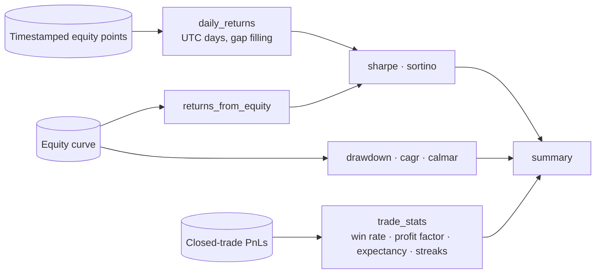

# backtest-metrics

[](https://github.com/sergiogoqui-cpu/backtest-metrics/actions/workflows/ci.yml)


Small, pure-Python performance metrics for trading backtests and live equity curves. No numpy, no pandas: just functions you can read, test and trust. Built for **24/7 markets** (crypto, 365 days a year) but works for any calendar.

```python
from backtest_metrics import summary, STOCKS_DAILY

equity = [10_000, 10_150, 10_090, 10_400, 10_380, 10_700]
pnls = [150, -60, 310, -20, 320]            # closed trades

summary(equity, pnls, periods_per_year=STOCKS_DAILY)
# {'total_return': 0.07, 'cagr': ..., 'sharpe': ..., 'sortino': ..., 'calmar': ...,
#  'max_drawdown': 0.0059, 'win_rate': 0.6, 'profit_factor': 9.75, 'expectancy': 140.0, ...}
# (5 data points annualised over a year are an extreme extrapolation: use real, long samples)
```

## Why

Most libraries assume the stock calendar (252 days) and silently annualise crypto wrong, skip days without data, or pull in a heavy dependency stack. This one:

| Pitfall | What it does |
|---|---|
| Wrong annualisation for 24/7 markets | `periods_per_year` is explicit; presets `CRYPTO_DAILY=365`, `STOCKS_DAILY=252`, `FOREX_DAILY=260` |
| Days without bars | `daily_returns` fills them with 0% (or skips them for stock calendars) |
| Bar closing exactly at midnight | Assigned to the *previous* UTC day (`trading_day`) |
| Undefined ratios (flat curve, no losses) | Return `0.0` / `inf` explicitly instead of crashing or `NaN` |
| Drawdown without context | `drawdown()` returns depth, peak, trough, recovery index and time underwater |
| Needs numpy to read | Plain loops and `math`; zero dependencies |

## How the pieces fit



## Install

```bash
pip install git+https://github.com/sergiogoqui-cpu/backtest-metrics.git
```

## Usage

### Daily returns from timestamped equity

```python
from datetime import datetime, timezone
from backtest_metrics import daily_returns, sharpe

curve = [
    (datetime(2026, 1, 1, 23, 59, tzinfo=timezone.utc), 10_100.0),
    (datetime(2026, 1, 3, 23, 59, tzinfo=timezone.utc), 10_302.0),  # Jan 2 had no data
]
rets = daily_returns(curve, start_equity=10_000.0)   # [0.01, 0.0, 0.02]
sharpe(rets, periods_per_year=365)
```

### Drawdown with context

```python
from backtest_metrics import drawdown

dd = drawdown([100, 120, 90, 100, 130, 117])
dd.max_drawdown        # 0.25
dd.peak_index          # 1
dd.trough_index        # 2
dd.recovery_index      # 4   (None if the curve never regained the peak)
dd.longest_underwater  # 2
```

### Trade statistics

```python
from backtest_metrics import trade_stats

s = trade_stats([10, -5, 20, -5, -5, 15])
s.win_rate, s.profit_factor, s.expectancy, s.payoff_ratio, s.max_consecutive_losses
```

### Risk-free rate

```python
sharpe(rets, periods_per_year=365, risk_free=0.04)   # annual rate
```

## API

| Function | Returns |
|---|---|
| `returns_from_equity(equity)` | Simple period returns |
| `daily_returns(curve, start_equity, fill_gaps=True)` | Regular daily returns from `(datetime, equity)` |
| `sharpe(returns, periods_per_year, risk_free)` | Annualised Sharpe |
| `sortino(returns, periods_per_year, risk_free)` | Annualised Sortino (downside deviation) |
| `drawdown(equity)` | `Drawdown(max_drawdown, peak_index, trough_index, recovery_index, longest_underwater)` |
| `cagr(equity, periods_per_year)` / `calmar(...)` | Growth rate / growth over max drawdown |
| `trade_stats(pnls)` | `TradeStats` |
| `summary(equity, pnls, ...)` | Flat dict with the headline numbers |

## Good practice

Metrics describe the past. A high Sharpe from a short or heavily optimised backtest is weak evidence: use out-of-sample data, walk-forward validation and tests for overfitting. See [strategy-robustness-kit](https://github.com/sergiogoqui-cpu/strategy-robustness-kit) for Deflated Sharpe Ratio and Monte Carlo drawdown.

## Development

```bash
pip install -e . pytest
pytest
```

## License

MIT. Issues and pull requests are welcome.
